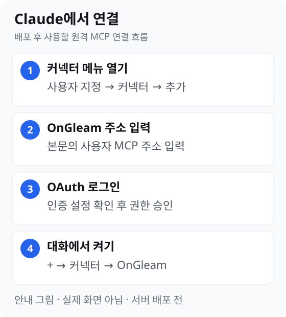
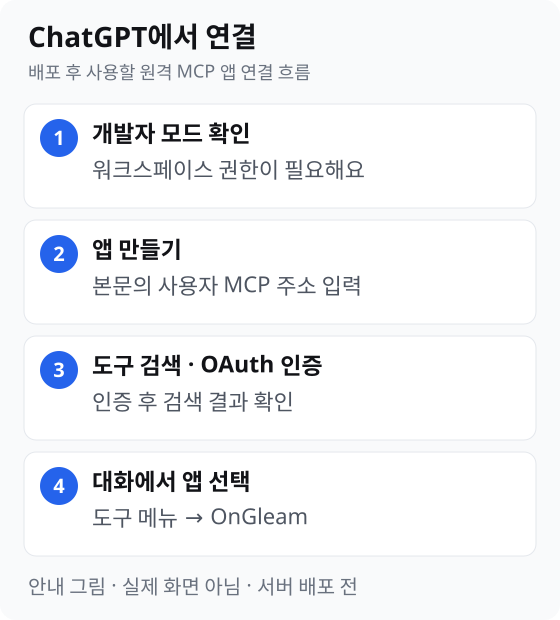

# OnGleam 사용자 플러그인

OnGleam의 일반 사용자용 Claude Code·Codex 스킬을 한 원본에서 배포한다. 현재는 `use-ongleam` 스킬만 제공한다. 사용자 MCP 서버와 OAuth가 아직 구현·배포되지 않아 이 패키지만 설치해도 데이터 조회나 수집은 실행할 수 없다.

기존 설치와 호환되도록 플러그인 이름은 `ongleam-beta`로 유지한다. 관리자 MCP, 개발 전용 E2E 스킬, 내부 정책·hook은 이 저장소에 포함하지 않는다.

## 설치

저장소를 clone한 뒤 루트에서 실행한다.

Codex:

```sh
codex plugin marketplace add .
codex plugin add ongleam-beta@ongleam-beta
```

Claude Code:

```text
/plugin marketplace add .
/plugin install ongleam-beta@ongleam-beta
```

호스트를 다시 시작하거나 지원되는 plugin reload를 실행한 뒤 `use-ongleam` 스킬을 확인한다. 같은 이름의 marketplace가 이미 등록된 경우 등록 위치를 확인하고 기존 설치를 교체한다. 설치 명령은 현재 사용자 호스트의 plugin 설정을 변경한다.

## Claude·ChatGPT에서 OnGleam MCP 연결

아래 그림은 **실제 화면 캡처가 아닌 단계별 안내 그림**이다. 현재 OnGleam 사용자 MCP 서버와 OAuth는 배포 전이므로 아래 주소로 연결하거나 인증을 완료할 수 없다. 배포 후 사용할 주소는 `https://beta-api.ongleam.com/mcp`이다. 이 절차는 웹 Claude·ChatGPT의 원격 MCP 연결이며, 위의 Claude Code·Codex 플러그인 설치와는 별개다.

### Claude



1. Claude의 **사용자 지정 커넥터** 화면을 연다. 개인 Pro·Max는 **사용자 지정 → 커넥터 → 추가 → 사용자 지정 커넥터 추가**로 이동한다. 무료 계정도 사용자 지정 커넥터 하나를 사용할 수 있다.
2. 이름을 `OnGleam`으로 정하고 원격 MCP 주소 `https://beta-api.ongleam.com/mcp`를 입력한다. 인증 설정을 확인한 뒤 OAuth 로그인을 진행한다.
3. 연결이 제공되면 대화의 **+ → 커넥터**에서 OnGleam을 켠다.

Team·Enterprise에서는 먼저 조직 소유자가 **조직 설정 → 커넥터 → 추가 → 사용자 지정 → 웹**에서 같은 주소로 커넥터를 등록해야 한다. 구성원은 **사용자 지정 → 커넥터**에서 등록된 커넥터를 찾아 연결한다. 메뉴 표기는 Claude의 언어·업데이트에 따라 달라질 수 있다. [Claude 공식 안내](https://support.claude.com/en/articles/11175166-get-started-with-custom-connectors-using-remote-mcp)를 확인한다.

### ChatGPT



1. 웹 ChatGPT에서 **개발자 모드** 사용 권한을 확인한다. Business는 관리자·소유자가, Enterprise·Edu는 관리자·소유자 또는 권한을 부여받은 개발자가 설정할 수 있다. Pro 개인 사용자는 사용자 설정에서 개발자 모드를 켠다.
2. **워크스페이스 설정 → 앱 → 만들기** 또는 권한이 허용된 **사용자 설정 → 앱 → 만들기**에서 OnGleam 앱을 만든다. MCP 주소 `https://beta-api.ongleam.com/mcp`를 입력하고 인증 방식을 선택한다.
3. **도구 검색**을 실행하고 OAuth 인증 창이 나타나면 OnGleam에 로그인한다. 검색이 끝난 뒤 앱을 만든다.
4. 새 대화의 도구 메뉴에서 앱을 선택한다. 워크스페이스 전체에 제공하려면 관리자·소유자의 게시 절차가 별도로 필요하다.

ChatGPT의 전체 MCP 기능은 현재 Business·Enterprise·Edu 웹에서 제공된다. Pro는 개발자 모드의 읽기·가져오기 권한으로만 사용자 지정 MCP를 연결할 수 있다. 기능과 메뉴는 베타 기간에 바뀔 수 있다. [ChatGPT 공식 안내](https://help.openai.com/en/articles/12584461-developer-mode-and-mcp-apps-in-chatgpt)를 확인한다.

## 개발 및 동기화

`plugins/ongleam-beta/plugin.json`은 이름·버전·설명의 원본이고, `skills/use-ongleam/SKILL.md`는 양쪽 호스트가 공유하는 사용 지침이다. manifest나 marketplace를 직접 수정하지 않는다.

```sh
bun run plugins:sync
bun run check
claude plugin validate ./plugins/ongleam-beta
claude plugin validate ./.claude-plugin/marketplace.json
```

생성 파일은 `plugins/ongleam-beta/.claude-plugin/plugin.json`, `plugins/ongleam-beta/.codex-plugin/plugin.json`, `.claude-plugin/marketplace.json`, `.agents/plugins/marketplace.json`이다. 변경 기여는 PR에서 검토한다.

beta 개발 저장소의 localhost 전용 플러그인은 이 저장소의 사용자용 `plugin.json`과 `use-ongleam` 스킬만 명시적으로 동기화한다. 향후 이 저장소에 사용자 MCP 설정이 추가되어도 이를 개발용 localhost 연결로 자동 복사하지 않는다.

## MCP 연결 상태

현재 `mcp.json`과 호스트별 MCP 연결 설정은 없다. 사용자 MCP 서버가 배포되면 실제 transport와 OAuth를 양쪽 호스트에서 검증한 뒤 **사용자 endpoint만** 추가한다. 관리자 endpoint, credential, 추정한 설정은 사용자 패키지에 넣지 않는다. 그때 스킬 발견, 인증, 허용 조직 조회, 조직 접근 거부, 작업 접수·상태 조회, 실제 UI↔MCP 교차 검증을 별도로 수행한다.
